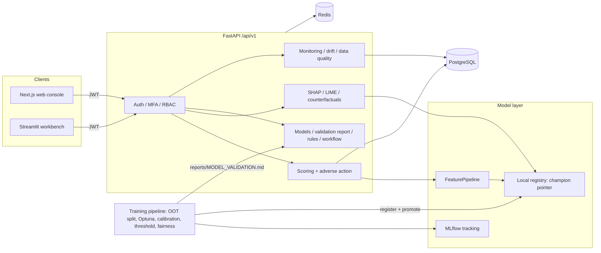
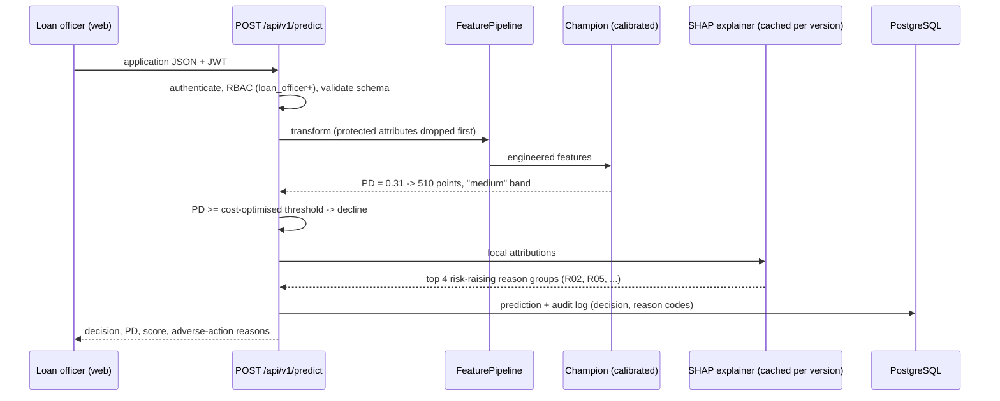

# Credit Risk Intelligence Platform

An end-to-end consumer credit decisioning platform, from raw application to a
calibrated probability of default, a cost-optimised approve/decline decision
and the legally required reasons for a decline. It is built and validated the
way a bank's model-risk team would expect.

**Live demo: [credit-risk-v3.vercel.app](https://credit-risk-v3.vercel.app)** — choose *Explore the live demo* to score an
application and see the decline reasons a lender must give. Details in [Hosted demo](#hosted-demo).


## Results (out-of-time test window)

Champion: **CatBoost**, trained on applications from 2023-01-01 to
2024-03-14 and tested on 10,000 later applications (2024-08-05 to
2024-12-30) that played no part in tuning, calibration, model selection or
threshold choice.

| Metric | Value |
|---|---|
| ROC-AUC | **0.860** (95% CI 0.851 to 0.869) |
| Gini | **0.720** |
| KS | **0.561** (95% CI 0.541 to 0.583) |
| Calibration | mean predicted PD 16.5% vs observed default rate 17.0% (ECE 0.009) |
| Riskiest decile | bad rate 67.2%, 3.9x lift; top 3 deciles capture 76% of defaults |
| Decision at PD ≥ 15.3% | approves 67% of applicants and catches 80% of defaults |
| Score stability | PSI train to OOT = 0.002 |
| Fair lending | passes the four-fifths rule for age band and marital status (lowest adverse impact ratio 0.94) |

Full report: [`reports/MODEL_VALIDATION.md`](reports/MODEL_VALIDATION.md), regenerated by every
training run. The data is synthetic (see [Data](#data)).

## What makes it production-grade

**Validation a model-risk reviewer would sign off.**
- **Out-of-time split.** 60% train, 20% validation and 20% OOT by application date. Calibration,
  champion selection and the decision threshold are all chosen on the validation window, and the
  OOT window is scored exactly once.
- **Credit metrics.** Gini, KS, decile gains/lift and bootstrap confidence intervals, alongside
  ROC-AUC, PR-AUC, Brier score and ECE.
- **Prefit isotonic calibration.** PDs are real probabilities, ready for expected-loss and capital
  use.
- **Parsimony rule.** An ensemble only replaces the best single model if it is materially better.
- **Monotonic constraints.** PD can never fall as delinquencies rise, or rise as the credit score
  rises. Tests check this on a trained model.

**Fair lending and adverse action (ECOA / Regulation B).**
- **Excluded inputs.** Age, marital status and state are never model inputs. They are kept only to
  test decisions for disparate impact (four-fifths rule, per-group calibration and AUC).
- **Reason codes on every decline.** Each decline returns up to four principal reasons, built from
  SHAP values aggregated into 14 reason groups. A factor that helped the applicant can never be
  cited. The reasons are written to the audit log.
- **Scorecard points.** Points-to-double-odds scaling: 600 = 50:1 odds, and every 20 points doubles
  the odds.

**Serving and operations.**
- **FastAPI with security built in.** JWT access and refresh tokens with rotation, TOTP MFA, account
  lockout, a 7-role RBAC model, rate limiting, security headers, correlation IDs and an audit log.
- **One feature pipeline for training and serving.** A single versioned `FeaturePipeline` artifact,
  so the two can't drift apart.
- **Registry decoupled from MLflow.** Promote and rollback are atomic pointer swaps, and serving
  never waits on MLflow.
- **Monitoring and data quality.** Per-feature PSI drift, latency percentiles, and validators for
  schema, missingness, outliers, duplicates and leakage.
- **Governance services.** A business-rule engine, a governed workflow engine with a manual-review
  gate, and Model Card / Data Card / compliance reports.

**Two front ends, one API contract.**
- **Next.js web console (`web/`).** Executive dashboard, application scoring with decline reasons,
  and the model-validation report.
- **Streamlit analyst workbench (`frontend/`).** SHAP and LIME, counterfactuals, segmentation,
  anomaly detection, loan restructuring and monitoring.

**MLOps.**
- **Containers.** Multi-stage, non-root Docker images for the API, web, Streamlit and ML jobs. The
  Compose stack runs Postgres, Redis, MLflow, the API and both front ends on isolated networks.
- **Migrations and deployment.** Alembic migrations, Kubernetes manifests, and deployment scripts
  for AWS ECS, GCP Cloud Run, Azure Container Apps, Render and Railway.
- **CI.** Ruff and Black, the pytest suite with coverage, web lint/type-check/build, pip-audit, and
  image builds.

## Architecture



A declined application, end to end:



## Hosted demo

The [live demo](https://credit-risk-v3.vercel.app) is the Next.js console on Vercel, which proxies `/api/*` to the API on
Render's free tier (512 MB). The full stack (PostgreSQL, Redis, MLflow and the Streamlit workbench) runs from
`docker-compose.yml`; the demo is the API and the web console.

- **The validated champion, not a retrain.** The image serves exactly the CatBoost model behind the results above and
  [`reports/MODEL_VALIDATION.md`](reports/MODEL_VALIDATION.md) ([`deploy/demo/champion/`](deploy/demo/champion), ~180 KB,
  produced by `make train` with the pinned library versions), so the numbers on the site and in this README are the same
  model's.
- **A populated dashboard.** At image build time [`scripts/demo_build.py`](scripts/demo_build.py) scores 300
  applications from the out-of-time window through `POST /predict`, skipping the generator's deliberately messy rows that
  intake validation rejects. Each start shifts them so the newest is current, keeping monitoring's 30-day window full.
- **Sign-in.** *Explore the live demo* (`POST /api/v1/auth/guest`, off unless `GUEST_ACCESS_ENABLED=true`,
  rate-limited) signs visitors in as a shared `risk_analyst`: scoring with adverse-action reasons, SHAP/LIME and
  counterfactual explanations, analytics, data quality and reports. It cannot promote models or administer users, and an
  account with more power is never handed out as the guest. Self-registration is off and every pre-existing account gets
  a random password at startup; the owner's administrator comes from hosting secrets (`CREDIT_ADMIN_USERNAME`,
  `CREDIT_ADMIN_PASSWORD`).
- **SQLite, explicitly.** Production mode refuses SQLite unless `ALLOW_SQLITE_IN_PRODUCTION=true`: right for one
  disposable instance, wrong for anything with replicas or data to keep. Every start copies the showcase afresh
  ([`scripts/demo_start.py`](scripts/demo_start.py)).
- **Free-tier behaviour.** The instance sleeps when idle, so the first visit after a pause takes about a minute.

Deploy files: [`render.yaml`](render.yaml), [`deploy/demo/Dockerfile`](deploy/demo/Dockerfile),
[`web/vercel.json`](web/vercel.json). [`deployment/render.yaml`](deployment/render.yaml) is the full Render stack on paid plans.

## Quickstart

**Docker (whole stack):**

```bash
cp .env.example .env               # set JWT_SECRET_KEY and POSTGRES_PASSWORD
make docker-up                     # postgres, redis, mlflow, api, streamlit, web
make docker-train                  # generate data, train, validate and promote a champion
docker compose exec api python -m scripts.create_admin --username admin --email admin@example.com
```

Web console at http://localhost:3000, API docs at http://localhost:8000/docs, Streamlit at
http://localhost:8501, MLflow at http://localhost:5000.

**Local (Python 3.10+, Node 20+):**

```bash
python -m venv .venv && source .venv/bin/activate   # Windows: .venv\Scripts\activate
make install-dev
cp .env.example .env
make train          # generates the 50k-application dataset if missing, trains, validates, promotes
make run-api        # http://localhost:8000/docs
make run-web        # http://localhost:3000   (second terminal)
make run-frontend   # http://localhost:8501   (optional Streamlit workbench)
```

The full training run takes roughly 25 minutes on a laptop. Optuna budgets are in
`configs/model_training.yaml`.

## Data

Consumer credit data is regulated (FCRA, GLBA, GDPR) and can't be published, so
`data/generate_synthetic_data.py` builds a **causally structured** dataset of 50,000 applications:

- **Known default process.** Default is a known logistic function of credit score, DTI,
  utilisation, delinquencies, derogatory marks, inquiries, loan-to-income, rate, employment and
  housing, plus label noise.
- **Realistic defects.** MAR missingness, heavy-tailed outliers, duplicate applications, and a
  slowly deteriorating credit cycle across the two-year window.
- **Protected attributes with no causal effect.** Age, marital status and state are present but
  have no effect on default by construction, which makes them a clean test bed for the
  fair-lending review.

These results show the methodology working on known ground truth. They are not a claim about
real-world performance. [`docs/MODEL.md`](docs/MODEL.md) lists what a real deployment would add.

## Project layout

```
api/             FastAPI app: routers (thin), schemas, middleware, dependency wiring
services/        Business logic: scoring + adverse action, auth, governance, monitoring, rules, workflow
repositories/    SQLAlchemy data access, one class per aggregate
database/        ORM models, sessions, Alembic migrations
feature_store/   Raw schema, feature catalog, the versioned FeaturePipeline
preprocessing/   Imputation, winsorisation, domain features, target encoding, selection
training/        Optuna tuning, monotone constraints, calibration, thresholds, ensembles, credit metrics
pipelines/       Staged training CLI: prepare -> tune -> train_final -> ensemble -> finalize
explainability/  SHAP/LIME, adverse-action reason codes, counterfactuals, narratives, PDF reports
analytics/       Fair-lending analysis, segmentation, anomaly detection, loan recommendation
data_quality/    Validators, profiling, PSI drift
models/          Local registry (register / promote / rollback)
reporting/       HTML reports: evaluation, comparison, drift, Model Card, Data Card
rules/ workflows/ plugins/   Business-rule engine, governed workflow, fraud-check extension point
web/             Next.js web console
frontend/        Streamlit analyst workbench
deployment/      Kubernetes manifests and cloud deployment scripts
reports/         Generated validation report (model_validation.json + MODEL_VALIDATION.md)
tests/           Unit, data, integration, API and infrastructure tests
```

## Testing

```bash
make test       # 429 tests: unit, data, integration, API (TestClient), infra (Dockerfiles/compose)
make lint       # ruff + black --check
cd web && npm run lint && npx tsc --noEmit && npm run build
```

Beyond the usual unit and API coverage, the tests pin down the properties that matter in credit:

- **Fairness invariance.** Changing age, marital status or state leaves the PD unchanged.
- **Monotonicity.** On a trained gradient-boosted model, PD never rises as the credit score rises.
- **Decline reasons.** Every decline carries ranked reasons that also appear in the audit log, and
  favourable factors are never cited.
- **Out-of-time ordering.** The train, validation and test windows are strictly chronological.
- **Champion selection.** The parsimony rule and the scorecard's PDO anchor are both covered.

## Documentation

| Doc | Covers |
|---|---|
| [MODEL.md](docs/MODEL.md) | Methodology: data, OOT validation, selection, calibration, threshold, fair lending, adverse action, limitations |
| [reports/MODEL_VALIDATION.md](reports/MODEL_VALIDATION.md) | The current champion's numbers |
| [ARCHITECTURE.md](docs/ARCHITECTURE.md) | System design and the decisions behind it |
| [API.md](docs/API.md) | Endpoint reference (interactive docs at `/docs`) |
| [SECURITY.md](docs/SECURITY.md) | Auth, MFA, token rotation, RBAC matrix, secrets, known gaps |
| [OPERATIONS.md](docs/OPERATIONS.md) | Health probes, configuration, backup and recovery, monitoring |
| [DEPLOYMENT.md](docs/DEPLOYMENT.md), [DOCKER.md](docs/DOCKER.md), [DOCKER_COMPOSE.md](docs/DOCKER_COMPOSE.md) | Running it anywhere |
| [DEVELOPER_GUIDE.md](docs/DEVELOPER_GUIDE.md), [TESTING.md](docs/TESTING.md), [TROUBLESHOOTING.md](docs/TROUBLESHOOTING.md) | Working on it |

## License

MIT, see [LICENSE](LICENSE).
