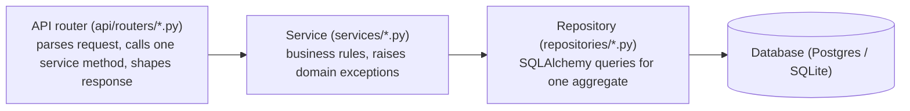

# Architecture

## System overview

The platform is split into four deployable units — a stateless FastAPI backend, two stateless
front ends that are both pure clients of the same `/api/v1` contract (the Next.js web console in
`web/` for underwriters and executives, and the Streamlit workbench in `frontend/` for analysts),
and a PostgreSQL database — plus Redis for shared caching and an MLflow tracking server used for
experiment history and as the system of record for model lineage. See the diagram in the
[README](../README.md#architecture) for the component map.

### Why a local model registry mirror instead of hitting MLflow at serving time

The MLflow Model Registry is authoritative for experiment history and stage transitions, but
coupling the prediction serving path's latency and availability to a live MLflow server is a
liability: every `/predict` call would depend on MLflow being reachable. Instead,
`models/registry.py` maintains a filesystem mirror (`models/artifacts/<version>/`) containing the
serialized model, the fitted `FeaturePipeline`, and metadata, plus a `champion.json` pointer file.
Promotion and rollback are simple, auditable pointer rewrites. The API only ever reads this local
mirror; MLflow stays fully decoupled from the serving path.

### Why the FeaturePipeline is versioned alongside the model, not separately

A `ModelBundle` couples the fitted model with the exact `FeaturePipeline` that produced its
training features (including the K-fold out-of-fold target encoder's learned category maps and
the feature selector's dropped-column list). Versioning them separately would risk serving a model
against a feature pipeline it wasn't trained on — a subtle, hard-to-detect production bug. Bundling
them means promotion/rollback always moves both together.

### Why OOF target encoding instead of plain target encoding

`preprocessing/target_encoding.py` computes out-of-fold target-encoded values during `fit` (via
`compute_oof_target_encoding`) rather than encoding each row with a mean computed from the full
training set. Plain target encoding leaks the row's own label into its own feature value through
the training-set mean, which inflates offline validation metrics without improving real-world
generalization. OOF encoding computes each row's encoded value using only the other folds.

### Why cost-sensitive threshold optimization instead of the default 0.5 cutoff

`training/threshold_optimization.py` selects the decision threshold that minimizes the business
cost matrix in `configs/model_training.yaml` (`cost_false_negative: 5.0`, `cost_false_positive:
1.0` by default) rather than defaulting to probability 0.5. In credit risk, approving a defaulter
(false negative) is materially more expensive than rejecting a creditworthy applicant (false
positive), so the optimal operating point is rarely 0.5.

### Why PR-AUC for model selection but ROC-AUC for Optuna's objective

`configs/model_training.yaml` separates `optimization_metric: roc_auc` (used inside each Optuna
trial, where a metric with lower variance across small CV folds speeds up the search) from
`selection_metric: pr_auc` (used for the final cross-model comparison). PR-AUC is more informative
than ROC-AUC under class imbalance — the dataset's default rate is a minority class — so it is the
more trustworthy signal once trial-level search noise is no longer a concern.

### Why RBAC is ordinal rather than a permission bitmask

`core/security.py`'s `RolePower(IntEnum)` (viewer=0 < loan_officer=1 < risk_analyst=2 < admin=3)
encodes roles as a strictly ordered hierarchy rather than an arbitrary permission-flag bitmask.
Every real permission boundary in this platform ("can score applications," "can promote models,"
"can view the audit log") happens to nest cleanly along a single seniority axis, so a bitmask would
add complexity without adding expressiveness.

## Layered architecture: API -> Service -> Repository -> Database

The API layer is deliberately three layers deep, each with a single responsibility and a
one-directional dependency (a layer only knows about the layer directly below it):

**Router.** Owns HTTP concerns only: request parsing (Pydantic validation), calling exactly one
service method, and shaping the response model. No business logic, no `Session` object, no
`try/except` — see `api/routers/auth.py`, `scoring.py`, `models.py`, `monitoring.py`.

**Service.** Owns business rules: duplicate-username checks, batch-size limits, risk-band
bucketing, promotion bookkeeping. Services depend on repositories and raise typed domain
exceptions from `core/exceptions.py` (`DuplicateResourceError`, `AuthenticationError`,
`ModelNotFoundError`, ...) rather than `fastapi.HTTPException` — this is what keeps the service
layer framework-agnostic and unit-testable with a plain in-memory SQLite session and no FastAPI
`TestClient` (see `tests/unit/test_services.py`). `api/app.py` registers one exception handler per
domain exception type, translating it to the correct HTTP status code in exactly one place.

**Repository.** Owns SQLAlchemy access for one aggregate (`UserRepository`, `PredictionRepository`,
`AuditLogRepository`, `ModelVersionRepository`, `DataQualityReportRepository`), all sharing a small
generic `BaseRepository[ModelT]` for the truly identical operations (get-by-id, list, add, delete).
This replaced the earlier flat `database/crud.py` module — appropriate for the schema's size
early on, but a real duplication risk once a service layer needed the same queries a router
used to call directly. See `repositories/__init__.py` and `repositories/base.py` for the full
rationale.

**Composition root.** `api/dependencies.py` is the only file that wires concrete repositories into
concrete services (`get_auth_service`, `get_scoring_service`, `get_model_governance_service`,
`get_monitoring_service`), each built from `Depends()` chains rooted in `get_db` /
`get_model_registry`. This is why `tests/conftest.py`'s `api_client` fixture didn't need any
changes when this layer was introduced: overriding `get_db` and `get_model_registry` alone is
enough — FastAPI's dependency resolution propagates the override through every repository and
service built on top of them automatically.

**Why `ModelGovernanceService` takes `bust_cache_fn` as a plain callable.** The in-process model
bundle cache (`api/dependencies.py::_cached_bundle`, an `lru_cache`) lives in the API layer. A
service must never import from `api/` — that dependency direction points the wrong way in a
layered architecture, and would create a circular import (since `api/dependencies.py` is what
constructs `ModelGovernanceService` in the first place). Injecting "a function that invalidates the
cache" as a constructor argument keeps the service layer's only knowledge of the API layer being
"someone will hand me a callback," which is the Dependency Inversion half of SOLID in practice.

## Data flow

See the [training pipeline diagram](../README.md#training-pipeline-data-flow) in the README.
Every stage (missing-value handling, outlier winsorization, feature engineering, target encoding,
one-hot encoding, feature selection) is a `sklearn`-compatible `fit`/`transform` step composed
inside `feature_store.pipeline.FeaturePipeline`, so the exact same code path runs at training time
and at serving time — no train/serve skew from reimplementing preprocessing logic twice.

## Request flow

See the [prediction sequence diagram](../README.md#prediction-request-sequence) in the README.
Every prediction is persisted to PostgreSQL (`Prediction` + `AuditLog` rows, via
`ScoringService` -> `PredictionRepository`/`AuditLogRepository`) for the monitoring dashboards and
the audit trail, regardless of whether the caller is the Streamlit frontend or a direct API
integration.

## Explainability path

SHAP explainers are built once per model version and cached in-process
(`explainability/explainer_cache.py`, bounded to the last few versions), so a promotion or rollback
naturally yields a fresh explainer on first use. The background sample is a slice of the model's
own training window that the training pipeline saves next to the artifact
(`models/artifacts/<version>/background_sample.csv`), so serving never depends on the raw data
lake. `/explain` talks to the `explainability/` package directly rather than through a service,
since it has no database writes.

The same cached explainer powers **adverse-action reasons** on the scoring path:
`services/scoring_service.py` asks for local attributions only when the decision is a decline,
and `explainability/adverse_action.py` aggregates them into ECOA / Reg B reason groups. Reason
generation is isolated so that its failure is logged loudly but never blocks the credit decision.
A `LimeExplainer` (`explainability/lime_explainer.py`) was added alongside the SHAP
explainer as an optional comparison method — see "Explainability + reporting" below.

## Analytics path (bonus features)

`analytics/segmentation.py` (KMeans) and `analytics/anomaly_detection.py` (IsolationForest) are
fit fresh per request against a reference sample of the training population, mirroring the SHAP
background-sample pattern. This always reflects the current champion model's feature space without
needing explicit cache invalidation on every promotion — an acceptable latency/simplicity tradeoff
at this project's scale; a high-QPS deployment would persist these fitted objects in the registry
alongside the model artifact instead.

`analytics/loan_recommendation.py` deliberately restricts its search to `loan_amount` and
`loan_term_months` — the two levers a loan officer can realistically renegotiate — rather than the
fully unconstrained counterfactual search already available via `/explain/counterfactual`.

## Enterprise cross-cutting infrastructure

A second pass added platform-wide concerns that sit *across* the layered architecture above
rather than inside any one layer — see `docs/API.md` for the resulting new endpoints.

**Correlation IDs.** `api/middleware.py::CorrelationIdMiddleware` generates (or accepts, via an
inbound `X-Correlation-ID` header) an ID per request and stores it in a `contextvars.ContextVar`
(`core/logging.py`). A `logging.Filter` attached to the root log handler reads that ContextVar and
tags every log line emitted during the request — router, service, repository, background task —
with zero changes needed to any business-logic code. This is what makes "find every log line for
one failed request" possible without threading an ID parameter through every function signature in
the codebase.

**Security headers.** `api/middleware.py::SecurityHeadersMiddleware` adds
`X-Content-Type-Options`, `X-Frame-Options`, `Referrer-Policy`, and `Permissions-Policy` to every
response, plus `Strict-Transport-Security` outside debug mode (HSTS is actively wrong advice for
`http://localhost`). Both new middleware classes are registered *last* in `api/app.py` so they end
up outermost in the stack — Starlette builds it in reverse registration order — ensuring a
correlation ID exists before anything else (CORS, rate limiting) logs a line.

**Caching.** `core/cache.py::InMemoryTTLCache` is a small thread-safe dict-based TTL cache behind a
`CacheBackend` protocol shaped like a Redis client (`get`/`set`/`delete`/`clear`), so swapping to
Redis for a multi-replica deployment is a one-file change with no call-site changes. Applied to
`ModelGovernanceService.get_comparison()` (60s TTL — this CSV only changes after a full retrain)
and `MonitoringService.get_stats()` (15s TTL — dashboard-polled frequently, staleness invisible to
a human). The model-*bundle* cache (`api/dependencies.py::_cached_bundle`) predates this and stays
as its own `lru_cache`, since it's explicitly invalidated on promote/rollback rather than
TTL-based — different cache, different invalidation strategy, deliberately not unified.

**Pagination.** `core/pagination.py` defines a generic `Page[T]` envelope and a `PaginationParams`
FastAPI dependency (`page`/`size`/`sort_by`/`sort_order`), applied to the two new admin listing
endpoints (`/admin/users`, `/admin/audit-logs`). It was deliberately *not* retrofitted onto the
pre-existing `/predict/history` endpoint — that endpoint already has a real caller (the Streamlit
frontend's Customer Search page) expecting a plain list response, and
changing its response shape would violate this pass's "don't break existing functionality"
constraint for zero benefit; a genuinely new endpoint was the safer place to introduce the pattern.

**Account lockout.** `User` gained three additive, nullable/defaulted columns
(`failed_login_attempts`, `locked_until`, `last_login_at`), captured in the initial Alembic
migration (`database/migrations/versions/0eb836e5dc7c_initial_schema.py`) alongside the rest of
the schema — every deployment path now runs `alembic upgrade head` at API startup (see
`database/session.py::init_db()`), so these columns are always present via the real migration
chain, not `Base.metadata.create_all()`'s implicit column tolerance. `AuthService.login()` locks
an account for `ACCOUNT_LOCKOUT_MINUTES` after
`MAX_FAILED_LOGIN_ATTEMPTS` (`core/constants.py`) and raises `AccountLockedError` — a *subclass* of
the existing `AuthenticationError`, so it's handled by the existing 401 handler via Starlette's
MRO-based dispatch with zero changes to `api/app.py`.

**Admin + audit surface.** `UserService` (admin-facing user CRUD/status/role/unlock) was split out
of `AuthService` (self-service register/login/refresh) because they have genuinely different
callers and RBAC requirements — every `UserService` method is only ever reached from an
admin-gated route. `AuditService` exposes the `AuditLog` table (already written to by every other
service) through a real, paginated, filterable read path for the first time — before this pass,
audit data was written on every login/predict/promote/rollback but nothing could ever read it back
out, which isn't really an audit trail.

**Rate limiting.** The `slowapi.Limiter` instance moved from `api/app.py` into `core/rate_limit.py`
so router modules can import the *same* instance and layer a stricter per-route
`@limiter.limit(...)` on top of the global default — `/auth/login` (10/minute, a brute-force
target) and `/predict/batch` (20/minute, an expensive-per-request endpoint). Routers importing the
limiter from `api/app.py` directly would have created a circular import, since `api/app.py` is what
imports and mounts the routers.

## Explainability + reporting

A third pass focused specifically on explainability and downloadable reporting, deliberately
scoped narrower than the full "enterprise AI platform" ask that prompted it — see the final
delivery summary in the project's chat history for what was scoped out and why (a feature store
with raw/clean/engineered separation, ensembles-as-a-first-class-registry-citizen, a business rule
engine, and formal fairness/model-card tooling were all deferred rather than half-built).

**LIME as a comparison method, not a replacement.** `explainability/lime_explainer.py::LimeExplainer`
wraps `lime.lime_tabular.LimeTabularExplainer`, exposed via `POST /explain/lime`. It's built in the
same transformed feature space `ModelExplainer` (SHAP) already explains in — see
`api/routers/explain.py::_build_lime_explainer` — so a caller can put SHAP's and LIME's
contributions for the same applicant side by side. The two are expected to sometimes disagree (SHAP
computes exact/approximate Shapley values; LIME fits a local *linear* surrogate, which can't
represent the feature interactions a tree-model champion actually exploits) — that disagreement is
informative to a risk reviewer, not a bug to reconcile, and is called out directly in the
Explainability Report (below).

**Why HTML reports, not a second PDF pipeline.** `reporting/html_report.py` provides a
self-contained HTML template (inline CSS, matplotlib figures embedded as base64 PNGs, no external
assets, no static-file server needed) shared by five new report generators. The existing
reportlab-based PDF applicant report (`explainability/report_generator.py`, served via
`/explain/report`) is completely unchanged and stays the format for anything that needs to be
printed or mailed (an adverse-action notice); the new HTML reports are for on-screen review by a
risk analyst or data scientist, where a second PDF pipeline would be pure ceremony.

**`reporting/evaluation_report.py`** computes a fuller metric set (accuracy, confusion matrix,
calibration curve, lift chart, gain chart, a 19-point threshold sweep) than
`training/model_comparison.py::evaluate_candidate` does during training-time model selection —
intentionally: the training-time function optimizes for fast cross-model ranking at a fixed 0.5
cutoff, while the Evaluation Report is generated on demand against the champion's own cost-sensitive
decision threshold, re-scoring the labeled reference dataset fresh rather than reusing a
training-time snapshot.

**`reporting/model_comparison_report.py`, `drift_report.py`, `performance_summary_report.py`**
are thin HTML renderings over data that already existed behind `ModelGovernanceService` and
`MonitoringService` — no new business logic, just a report-shaped view of it. The Performance
Summary Report explicitly documents (in the rendered report itself, not just in code comments) that
error-rate tracking isn't instrumented yet, rather than fabricating a number.

**`reporting/explainability_report.py`** is the HTML sibling of the existing PDF applicant report,
additionally including the LIME comparison section the PDF version doesn't have.

**New router.** `api/routers/reports.py` assembles all five report types purely by calling existing
services and explainability building blocks (reusing `api/routers/explain.py`'s private
`_build_explainer`/`_build_lime_explainer` helpers rather than duplicating them) — no new business
logic lives in the router itself, consistent with every other router in this codebase.

## Data quality: validation + profiling + quality dashboard

A fourth pass, scoped narrowly out of a much larger "enterprise data platform" ask — see the final
delivery summary in the project's chat history for the full list of what was scoped out (the
20-table schema expansion, Alembic migrations, feature-store lineage/versioning, an ETL pipeline,
Redis caching, backups, and encryption at rest were all deferred rather than half-built).

**Validation vs. profiling vs. scoring are three separate, independently callable modules**, not one
monolith, because they answer three different questions and have three different callers in mind:
`data_quality/validators.py` answers "is this data broken?" (pass/fail issues with severities, for
a CI gate or an automated alert); `data_quality/profiling.py` answers "what does this data look
like?" (descriptive statistics, for a human doing exploratory review, with no verdict attached);
`data_quality/scoring.py` answers "give me one number for a dashboard" (a composite 0-100 score
built from the other two). A caller who only wants a profile of a new CSV doesn't have to run the
full validation suite to get it, and vice versa.

**Validators expanded this pass:** `validate_dtypes()` catches the "a CSV import silently parsed a
numeric column as strings" class of bug (numeric columns must be numeric-typed, categorical columns
must be string-typed) before it reaches the feature pipeline, where it would otherwise fail with a
much less obvious error deep inside `OneHotEncoder`/`OutlierWinsorizer`. `validate_null_threshold()`
is a single explicit hard gate — one critical issue if the *worst* column's null rate exceeds a
configurable budget — deliberately distinct from `validate_missing_values()` (which reports every
column's missing rate at graduated severity): the hard gate answers "did anything blow the budget,
yes or no" without a caller having to inspect every column. `validate_business_rules()` runs a list
of `BusinessRule` predicates that check *relationships between columns* (loan amount vs. income,
utilization vs. credit limit, delinquency recency vs. count) — the class of "technically valid but
nonsensical" record that per-column range checks in `validate_schema()` can't catch on their own.
`default_credit_business_rules()` ships three domain rules out of the box; callers can pass their
own list to `run_full_validation(..., business_rules=...)`.

**Profiling (`data_quality/profiling.py`, new)** computes per-column statistics (numeric:
mean/std/percentiles/skew; categorical: top-5 value counts), the top-15 strongest pairwise
correlations, a missing-value summary, exact-duplicate analysis, IQR-based outlier summary,
cardinality (flagging high-cardinality categorical columns, never numeric ones — a numeric column
having many unique values is normal, not a data-quality smell), and a small business summary
(target positive rate, class counts, median income/loan/credit-score). A pre-existing bug in
`preprocessing/outliers.py::detect_outliers_iqr()` — a `KeyError` on datasets with zero numeric
columns, because `pd.DataFrame([]).sort_values("pct_outliers")` has no such column to sort by — was
fixed as part of wiring this up, since an all-categorical extract is a realistic profiling input.

**Scoring (`data_quality/scoring.py`, new)** produces one composite `overall_score` (0-100) as the
equal-weighted average of validity (100 minus a per-issue severity penalty), completeness (100 minus
the % of missing cells), and uniqueness (100 minus the % of duplicate rows). Freshness (dataset file
age in hours, when a `dataset_path` is supplied) is reported *alongside* the score but deliberately
never blended into it — a perfectly clean dataset that's a year old shouldn't score lower on
*quality*; staleness and quality-defects have different remediation paths (refresh the extract vs.
fix the pipeline) and conflating them into one number would hide which one a caller needs to act on.

**`DataQualityService` (new) closes the "the table and repository exist but nobody reads/writes
through them" gap** for `DataQualityReport`/`DataQualityReportRepository` — both have existed since
an earlier repository/service-layer pass, but nothing ever called `save_report()`; validation and
profiling results were computed on demand by ad hoc scripts and thrown away, never queryable as
history. This mirrors the exact same pattern already fixed for the audit log (`AuditService`) in an
earlier pass. `DataQualityService.run_and_persist()` runs validation + profiling + scoring against a
DataFrame and persists the combined result; `get_latest()` and `list_history()` (paginated, via the
same `Page[T]`/`PaginationParams` convention used by every other listing endpoint) read it back.

**New router (`api/routers/data_quality.py`) and report (`reporting/data_quality_report.py`).**
`POST /data-quality/run` is the one mutating endpoint (persists a new report row, `risk_analyst`
role required); `GET /data-quality/latest` and `GET /data-quality/history` are pure reads. Both the
run and the report endpoints default to the reference dataset (`data/raw/credit_applications.csv`)
rather than accepting an arbitrary upload — chunked multi-format file ingestion (CSV/Excel/JSON/ZIP)
was explicitly out of scope for this pass. `GET /reports/data-quality` renders the HTML report for
the *latest persisted* run only; it deliberately does not trigger a fresh run itself, since that's a
mutating, persistence-writing operation that belongs behind an explicit `POST` a browser tab or
crawler couldn't trigger by accident.

## Security, RBAC & reliability hardening (latest pass)

Full detail lives in `docs/SECURITY.md`, `docs/OPERATIONS.md`, and `docs/TESTING.md` — this section is a pointer for readers of the architecture doc, not a duplicate.

**RBAC: ordinal ladder + lateral roles.** `core/security.py::RolePower` models a strict linear hierarchy for five roles (`viewer < loan_officer < risk_analyst < admin < super_admin`); `auditor` and `ml_engineer` are deliberately excluded from that enum and instead granted access via `require_roles(*allowed)` (explicit allow-list) at each endpoint that should admit them, because their real-world permission shape (read-heavy-no-writes for auditor; model-governance-writes-no-user-management for ml_engineer) doesn't fit anywhere on a single ladder without over- or under-granting.

**Registration lockdown closed a real privilege-escalation gap.** The public `POST /auth/register` previously accepted any `role` value including `admin`. It's now a dual-layer defense: the request schema only accepts self-service roles at the type level, and the service layer independently re-validates for every caller without an authenticated `requesting_user`. Privileged accounts now require either an authenticated admin (`POST /admin/users`) or an out-of-band CLI (`scripts/create_admin.py`) — never anonymous HTTP.

**Refresh token rotation without a token store.** `User.token_version` (a plain integer) is embedded in every refresh JWT's `ver` claim; a mismatch against the user's current stored value means the token was already consumed (or belongs to a session that's since been superseded), so it's rejected. Avoids the operational overhead of a server-side revocation list while still making stolen refresh tokens single-use.

**Startup lifecycle.** `api/app.py` moved from the deprecated `@app.on_event` decorator to a `lifespan` async context manager. Startup now runs `settings.validate_or_raise()` (fail fast on an insecure production config — see `docs/SECURITY.md` §5) before `init_db_with_retry()` (exponential-backoff retry against a database that isn't accepting connections yet, smoothing over `docker compose up` cold-start races). Shutdown releases the cache backend's connection and disposes the SQLAlchemy engine's pool.

**Reflected-XSS fix in HTML reports.** `reporting/html_report.py::render_report()` now escapes `title`/`subtitle` before interpolation — one of those values (the explainability report's applicant-ID subtitle) traces back to a request body field, so it was a real (if narrow) reflected-XSS vector before this fix. `body_html` remains intentionally un-escaped, since it's assembled from trusted templates plus already-escaped table data.

## Business Rule Engine, Workflow Engine & Configuration Center

Three interconnected subsystems, added additively alongside the existing prediction
path — nothing described elsewhere in this document changed to accommodate them.

**Business Rule Engine (`rules/engine.py`, `services/rule_service.py`, `/rules/*`).**
Rule conditions are a small closed JSON grammar — `{"field", "operator", "value"}` leaf
nodes, composed via `{"all": [...]}`/`{"any": [...]}` — never a free-text expression
passed to `eval()`. This is a hard security boundary (an admin-editable rule must never
become a remote-code-execution vector) and keeps every match mechanically explainable
("this rule fired because `credit_score (480) lt 500`"). `evaluate_rules()` sorts active
rules by ascending priority and returns the first match as the override decision
(first-match-wins, for a single auditable "which rule decided this" answer), while
still recording every match that *would* have fired in `all_matches` for admins
reviewing overlapping rules. Edits bump `BusinessRule.version` and snapshot the
previous state into the audit log (`action="rule.update"`) rather than a dedicated
rule-history table — the same "reuse the audit log" pattern already used for other
change history in this platform.

**Enterprise Workflow Engine (`workflows/engine.py`, `services/workflow_service.py`,
`/workflow/*`).** `WorkflowRunner` times and records each of ten named steps
(validation → data quality check → fraud check → AI prediction → business rules →
manual review → decision → report generation → notification → audit logging) into a
persisted `WorkflowExecution` row. `POST /workflow/execute` sits ALONGSIDE
`POST /predict`, not in place of it: both ultimately call the same
`ScoringService.score_single()`, so a prediction is identical either way — the
workflow engine adds process and governance around the prediction, not a different
computation. The fraud-check step is genuinely a placeholder
(`plugins/fraud_detection/`), recorded as `skipped` with an honest reason when
disabled (the default) rather than faked as "completed".

**Enterprise Configuration Center (`services/config_service.py`, `/config/*`).** One
generic `SystemConfig` table (`key`/`value`/`category`) rather than a dedicated table
per config domain — the actual number of config keys the platform needs (workflow
toggles, the manual-review probability band, feature flags, notification settings) is
small enough that a single table is the right level of abstraction. `DEFAULT_CONFIG`
seeds safe defaults so the platform behaves sensibly before an admin has ever opened
the Configuration Center; reads merge persisted overrides with still-at-default keys
and tag each as `is_default` so an admin UI can distinguish the two.

**AI Governance (`reporting/model_card_report.py`, `reporting/data_card_report.py`,
`services/governance_service.py`, `/reports/model-card`, `/reports/data-card`,
`/reports/compliance-dashboard`, `/copilot/summary/governance`).** The Model Card and
Data Card are documentation-style HTML reports built from data other modules already
compute (evaluation metrics, model registry metadata, the latest data-quality report)
— they explicitly state what they do NOT cover (a real fairness/disparate-impact audit
against protected-class data) rather than fabricating one. The Compliance Dashboard
and its Copilot narrative layer compute nothing new: `GovernanceService` reads
directly from `ModelGovernanceService`, `RuleService`, `WorkflowService`, and
`DataQualityService` so the raw JSON dashboard and the narrative summary can never
report different numbers for the same underlying state. "Decision Log" and "Approval
History" (requested explicitly in this pass) are intentionally NOT new tables — they're
the existing `AuditLog` (`action="workflow.execute"` entries) and `WorkflowExecution`
history respectively, reused rather than duplicated.

**Plugin pattern (`plugins/`).** Purely additive — no existing router, service, or
repository was moved into it. Only `plugins/fraud_detection/` exists today, as a
genuine, explicitly-disclosed placeholder with the stable interface
`run_fraud_check(application: dict) -> dict` the Workflow Engine already calls.
Deliberately no empty stub directories for hypothetical future plugin categories,
consistent with this platform's "remove placeholders" cleanup principle from the
2.1.0 pass.

## Additional diagrams

- [`docs/diagrams/er_diagram.md`](diagrams/er_diagram.md) — entity-relationship diagram
  of the full database schema, generated from `database/models.py`.
- [`docs/diagrams/request_lifecycle.md`](diagrams/request_lifecycle.md) — how a single
  authenticated request flows through the middleware, RBAC, and service/repository
  layers, and exactly where each security control (rate limiting, JWT verification,
  role checks) is enforced.

(The high-level system architecture flowchart, prediction-request sequence diagram, and
training-pipeline data-flow diagram live in `README.md`'s "Architecture" section.)
