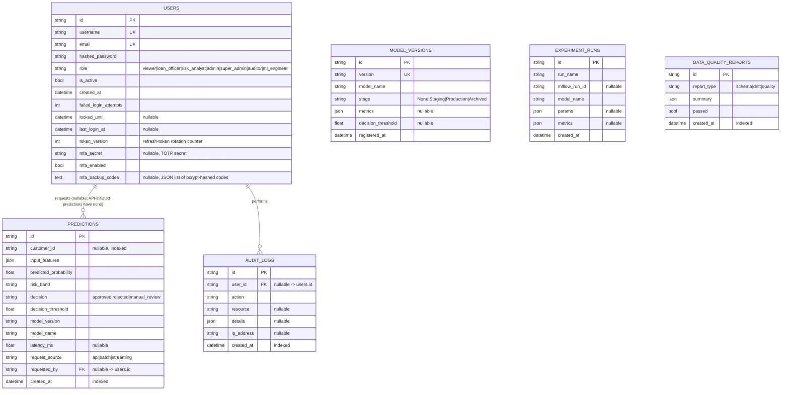

# Entity-Relationship Diagram

Generated from `database/models.py` (the single source of truth for schema — see
`docs/OPERATIONS.md`'s "Database migrations" section for how `database/migrations/`
keeps this in sync via Alembic).

## Notes

- **`MODEL_VERSIONS` and `EXPERIMENT_RUNS` have no foreign keys into `USERS`.** These
  mirror the local `ModelRegistry` / MLflow tracking store into Postgres for fast
  dashboard queries — the filesystem/MLflow store remains the source of truth for the
  artifacts themselves, and "who promoted this version" is recorded in `AUDIT_LOGS`
  (`action="model.promote"`, `resource=<version>`) rather than a column here, since an
  audit trail belongs in the audit log, not duplicated onto the domain table.
- **`PREDICTIONS.requested_by` is nullable** because not every prediction is tied to an
  authenticated user session — batch/streaming ingestion paths can score applications
  without a `current_user` in scope.
- **All primary keys are UUIDv4 strings**, not auto-incrementing integers — see
  `database/models.py::_uuid()`. This avoids leaking a row-count/creation-order signal
  through predictable IDs (a resource-ID enumeration/information-disclosure concern
  independent of the RBAC layer) and keeps IDs generation-agnostic between SQLite
  (local dev) and PostgreSQL (production).
