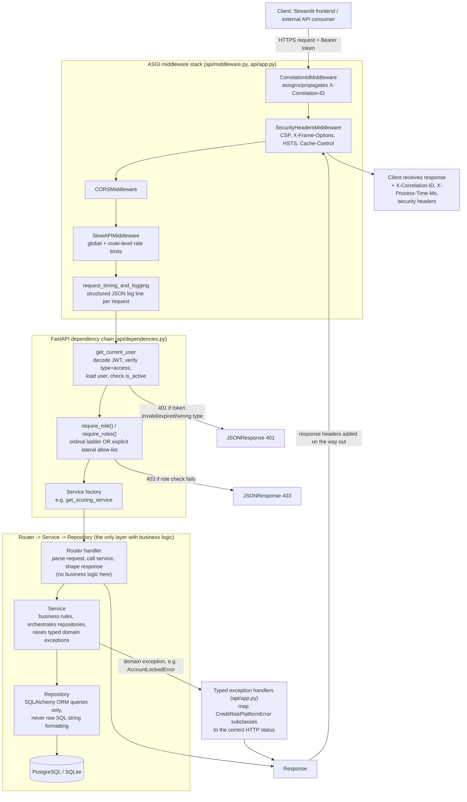

# Request Lifecycle & Security Layers

How a single authenticated API request actually flows through the stack, in the order
each layer is applied — useful alongside `docs/SECURITY.md` when reasoning about
*where* a given control is enforced.

## Why this ordering matters

- **Correlation ID is assigned before anything else runs** so every subsequent log
  line — including a rejected-at-the-door 401/403 — carries it, which matters for
  reconstructing an incident from logs alone.
- **Rate limiting runs before authentication is even checked** for most endpoints
  (global default), so a credential-stuffing burst against `/auth/login` is throttled
  before it reaches `AuthService.login()`'s account-lockout logic at all — two
  independent layers of brute-force defense (see `docs/SECURITY.md` §1.5).
- **RBAC runs strictly after authentication**, never combined into one check — a
  request with a missing/invalid token always fails as 401 (authentication), never
  403 (authorization), which matters for not leaking "this resource exists but you
  can't see it" information to a fully unauthenticated caller.
- **The router layer never talks to the database directly** — every arrow from
  `ROUTER` goes through `SERVICE` then `REPO`. This is what makes `services/*.py`
  independently unit-testable (see `docs/TESTING.md`) without spinning up FastAPI at
  all.
